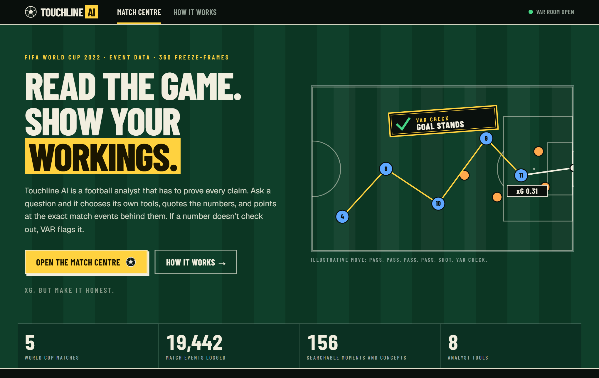
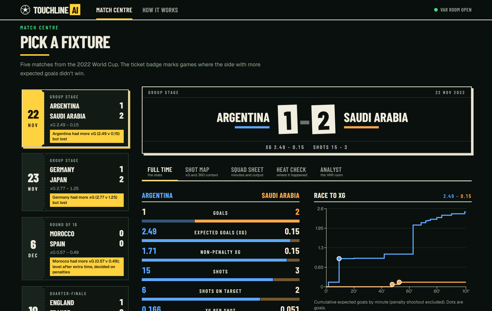
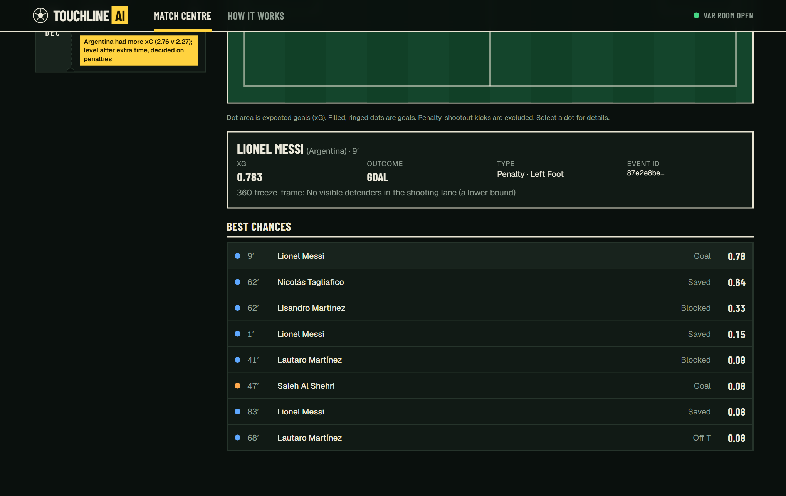
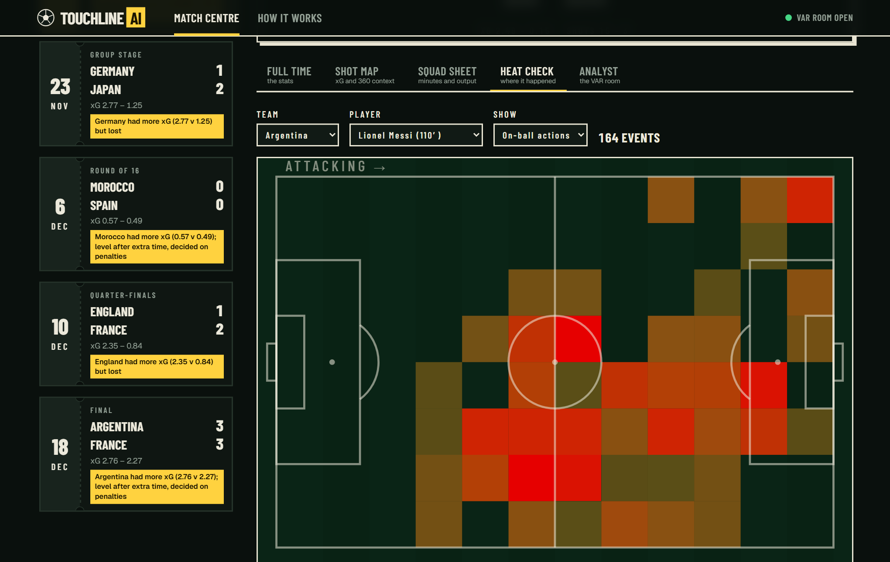
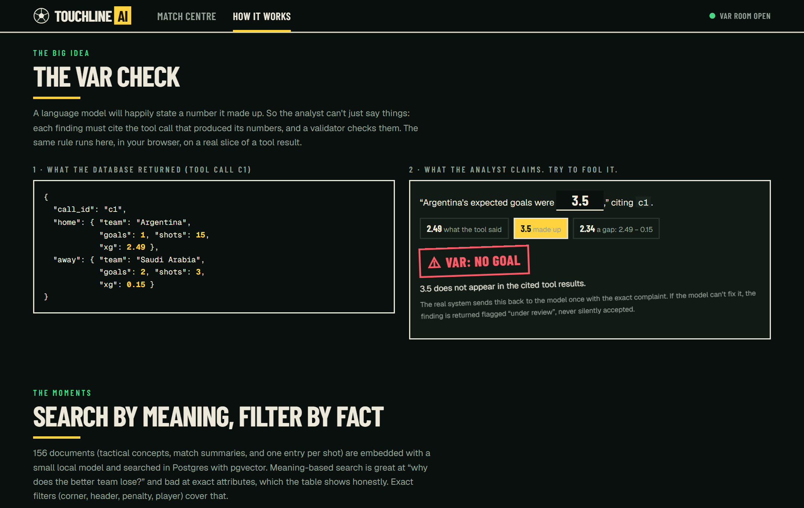
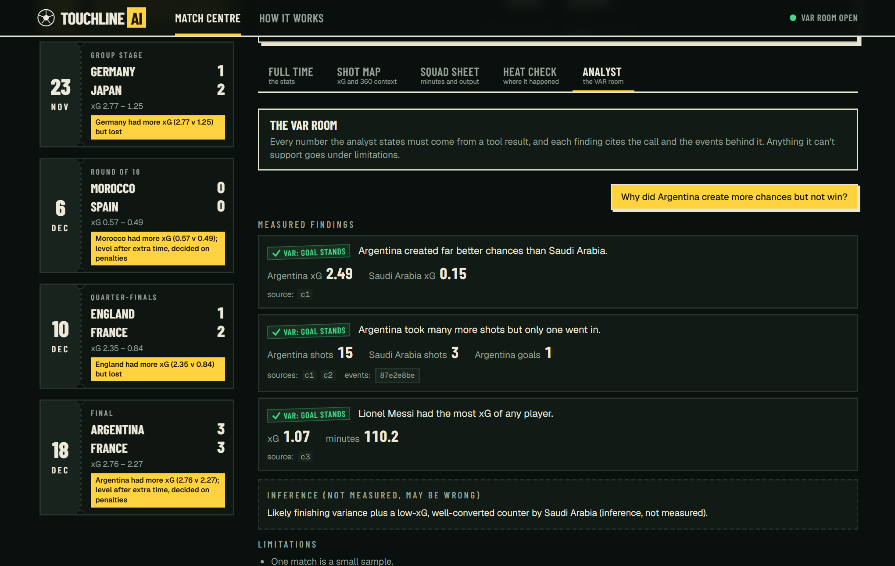
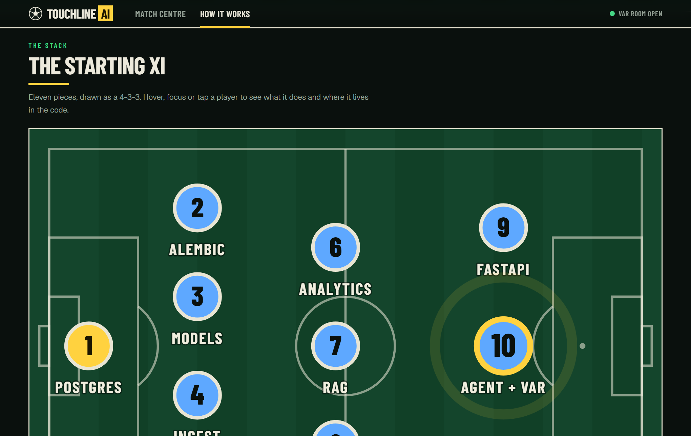
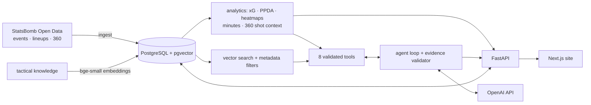
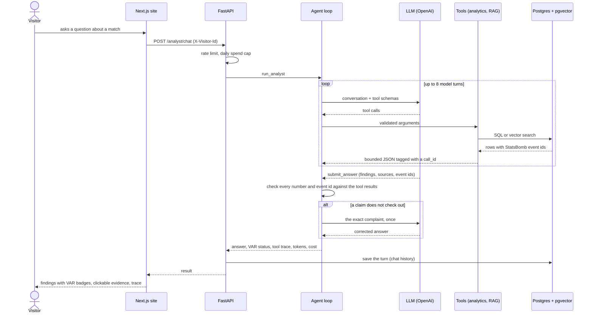
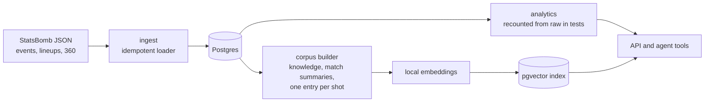

# Touchline AI

**Read the game. Show your workings.**
A football analyst that has to prove every claim. It chooses its own tools, quotes the numbers, and cites the exact StatsBomb
match events behind them. A validator checks each claim against what the tools returned, and anything it cannot verify is
flagged for VAR review, not hidden.



| Match Centre | Shot map with 360 context |
|---|---|
|  |  |
| **Heat Check** (amber to red) | **The VAR check, on the About page** |
|  |  |


*The analyst panel above renders a recorded response (a scripted run over the real database) so the screenshot needs no API
key. See "What is and is not proven".*


*The About page draws the stack as a 4-3-3: hover a player to see what it does and where it lives in the code.*

## What it does

- **Match Centre** over a five-match FIFA World Cup 2022 sample: ticket-stub fixtures, a scoreboard, team stats and an xG race,
  a shot map (dot area = xG) with 360 shooting-lane context, a squad sheet with minutes played, and red heatmaps.
- **The Analyst (the VAR room):** a tool-calling agent (function calling, structured output, multi-step reasoning) with eight
  validated tools, including RAG search over tactical knowledge and individual shot sequences. OpenAI by default
  (`gpt-5.6-luna`); Anthropic also wired in.
- **Evidence you can click.** An event id in an answer opens that exact shot on the map.
- **History that stays.** Questions and answers are stored per anonymous visitor in Postgres and come back after a reload,
  a match switch or a restart.
- **A "How it works" page:** the stack drawn as a starting XI (hover a player), the pipeline, a VAR check you can try to fool,
  the measured numbers, and an honest list of limits.

## Architecture



Details and every design decision: [docs/architecture.md](docs/architecture.md). Data fields and the quirks found while
inspecting the dataset: [docs/data-dictionary.md](docs/data-dictionary.md).

## Workflow

### From a question to a checked answer



### From raw data to something you can query



### How changes ship

1. A schema change is an Alembic migration (`alembic revision --autogenerate`), reviewed and committed with the model change.
2. Every module has tests next to it; metrics are checked against the raw StatsBomb files, not against themselves.
3. CI (`.github/workflows/ci.yml`) runs the migrations plus `alembic check`, the API tests, web lint, type-check, unit tests
   and build, then the Playwright suite against a production build and the real API.
4. The same Dockerfiles run locally, in CI and on the host: `docker compose --profile full up` is the whole product.

## Run it

**Everything in Docker** (db + API + web):

```powershell
$env:OPENAI_API_KEY = "sk-..."      # optional: enables the analyst (default model: gpt-5.6-luna)
docker compose -f infra/docker-compose.yml --profile full up --build
# site http://localhost:3000   API docs http://localhost:8000/docs
```

The API container migrates the database, downloads and loads the sample matches, and builds the search index on first start.
Without a key everything works except the analyst (it answers 503 with a clear message).

**For development** (Windows PowerShell, from the repo root):

```powershell
docker compose -f infra/docker-compose.yml up -d            # Postgres + pgvector on host port 5433
py -m venv apps/api/.venv; .\apps\api\.venv\Scripts\Activate.ps1
pip install -r apps/api/requirements.txt
cd apps/api
python -m app.services.bootstrap                            # migrate, load data, build the index (idempotent)
uvicorn app.main:app --reload                               # http://127.0.0.1:8000/docs
cd ../web; npm install; npm run dev                         # http://localhost:3000
```

Configuration is in `.env.example`.

## Deploy (Render + Vercel)

`render.yaml` defines the API and its Postgres (pgvector); `apps/web` deploys to Vercel with
`NEXT_PUBLIC_API_URL` pointing at the API. Step by step, with the CORS hand-off and a post-deploy checklist:
[docs/deployment.md](docs/deployment.md). These hosted steps are written but **not run** from this repository (they need your accounts).

## What I measured

| Check | Result |
|---|---|
| API tests (pytest) | 129 passing: metrics recounted from raw JSON, official scores and known facts; retrieval eval; agent loop; OpenAI and Anthropic providers; limits; chat history; caching; bootstrap |
| Web tests | 15 unit (Vitest) + 30 end-to-end (Playwright, real API, only the LLM mocked, run against a production build) covering the hero, tabs, red heatmaps, the About page, analyst states, history restore and a mobile layout regression |
| Mutation checks | Done by hand for each module (wrong zone constant, ignored filter, dropped substitutions, disabled validator, no rate limit, cache without a lock, ...): every one made tests fail, and two weak tests were found and strengthened this way |
| Schema drift | `alembic check` clean; CI fails if models and migrations disagree |
| Retrieval, 20 natural-language questions | recall@3 **1.00**, top-1 0.95, MRR 0.97 (first run 0.90 / 0.85 / 0.88; improved by rewording documents, not queries) |
| Retrieval weakness (documented) | Dense search alone got **0/3** on "goal from a counter-attack", so search takes exact metadata filters |
| Minutes played | Each team sums to exactly 11 × match length in all 5 matches. Lineup position spells failed this check in the two extra-time matches, so minutes come from substitution events |
| 360 shooting-lane count | A **lower bound** (11 of 25 blocked shots show 0 visible defenders); it still tracks xG (clear lane ≈ 0.18, 2+ visible defenders ≈ 0.05) |
| Performance | A browser test run showed `/stats` taking 5 s under concurrent load; analytics are now cached with a per-key lock: 146 ms first call, 11 ms cached |
| Docker | Both images build and run; the browser suite passes against the containers. API 345 MiB resident with the embedding model loaded |

## The agent

A custom loop (no framework) in [`apps/api/app/agents/analyst.py`](apps/api/app/agents/analyst.py):

1. The model picks tools; arguments are validated, and tool errors go back to it as error results so it can recover.
2. It must finish with `submit_answer`: findings (each with numbers, cited `call_id`s and event ids), an inference field,
   and limitations.
3. `validate_answer` checks every number and event id against the tool results. A failure is returned to the model once;
   what is still unverified comes back flagged ("VAR: under review").
4. Step limit, refusal, and "answered in prose" are explicit outcomes. Cost, tokens and latency are returned with each answer.
5. Per-visitor rate limits, a daily per-visitor cap, a global daily **spend budget** and a concurrency cap protect a public demo.

An eval harness (`python -m app.evals.agent_eval`, `--model` to compare) scores nine golden questions (two are questions the
data cannot answer; declining is the right result) for pass rate, groundedness, numeric accuracy, tool use, latency and cost.

## What is and is not proven

Proven here: everything in "What I measured".

**Not proven yet, stated plainly:**

- **The analyst's answer quality and cost per question are unmeasured.** The loop, validator, tools, API, history and UI are
  tested with a scripted model and a mocked client, and the OpenAI request shape was corrected after a real API call rejected
  it (reasoning effort is not allowed with function tools on Chat Completions, so the default effort is `none`). But no full
  run of the eval against a live model has been recorded. Run it with a key before quoting any accuracy or cost number. The
  cost shown in `docs/architecture.md` is an estimate from prompt sizes.
- **It is not deployed.** Dockerfiles, `render.yaml`, `vercel.json` and CI (`.github/workflows/ci.yml`) are written, and the
  Docker stack was run locally; the CI workflow has not run on GitHub and the Render/Vercel steps have not been executed.
- **Event data only**: no player tracking, no video-derived formations, and it says so. Expected threat and VAEP are
  explained in the knowledge base but not computed. One sample competition, five matches.
- The rate limiter and the analytics cache are per process (right for one instance).

## Layout

```
apps/api    FastAPI: app/{api,core,models,schemas,services,agents,tools,evals}, migrations/ (Alembic), tests/
apps/web    Next.js: src/{app,components/{ui,site,home,match,about},lib,content}, e2e/ (Playwright), scripts/screenshots.mjs
data        knowledge/ (tactical knowledge base), samples/ (the five matches); raw downloads are git-ignored
docs        architecture.md, data-dictionary.md, deployment.md, img/ (screenshots)
infra       docker-compose.yml          render.yaml (repo root)     apps/web/vercel.json
```

## API

`/health`, `/health/ready`, and under `/api/v1`: `competitions`, `matches`, `matches/{id}` (+ `/stats`, `/shots`, `/players`,
`/heatmap`), `search`, `analyst/status`, `analyst/chat`, `analyst/history` (GET, DELETE; header `X-Visitor-Id`). Docs at `/docs`.

## Data and attribution

Match data: [StatsBomb Open Data](https://github.com/statsbomb/open-data). StatsBomb requires attribution wherever analysis
built on it is published; the site shows it in the footer. The embedding model is `BAAI/bge-small-en-v1.5` (MIT).
