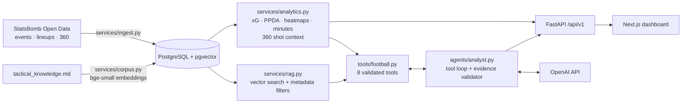

# Architecture

## Layout

- `apps/web`: Next.js 16 + TypeScript + Tailwind. Client components fetch from the API (the app is interactive and the API is separate, so nothing needs server-side data fetching). Selected match and tab live in the URL hash, so every view is linkable.
- `apps/api`: FastAPI. `api/routes.py` (HTTP) -> `services/` (analytics, ingestion, RAG) -> `models/tables.py` (SQLAlchemy). `tools/` and `agents/` hold the analyst. `core/` holds config, database, and rate limits. Migrations are in `migrations/` (Alembic).
- Postgres 16 + pgvector (Docker, host port **5433** because a native Postgres often owns 5432). One store for relational data and embeddings.

## Data model

`competitions` -> `seasons` (key `(competition_id, id)`: StatsBomb reuses season ids across competitions) -> `matches` -> `events` -> `shots`; plus `teams`, `players`, `player_minutes`, `documents`.

- `events.id` is the StatsBomb event UUID. It is the **evidence reference**: findings cite it, and the UI opens the shot it points to.
- `events.raw_data` (JSONB) keeps the full original event, so no field is ever lost.
- `shots` is a typed extract of Shot events (xG, outcome, type, coordinates, 360 context). `is_shootout` marks period-5 kicks.
- `documents` holds embeddings (`vector(384)`) with a `meta` JSONB that carries event ids for retrieved shot sequences.

## Analytics (all verified against raw events in tests)

| Metric | Definition and decision |
|---|---|
| goals, shots, xG | Periods 1-4 only. **Penalty-shootout kicks are excluded** (they are Shot events but not chances; counting them inflates totals) and reported as `shootout_goals`. |
| PPDA | Opponent passes in their own 60% of the pitch ÷ this team's defensive actions (tackles, interceptions, fouls, dribbled-past challenges) in the same stretch. Lower = more intense press. Recounted from raw events in tests. |
| minutes played | **Built from Starting XI, Substitution and red-card events, not lineup position spells.** The spells are inconsistent in extra-time matches (backwards spells; substituted players recorded as playing on). The events pass an exact check: each team's minutes sum to 11 × match length in all 5 matches. Times are converted to elapsed minutes because the match clock restarts in extra time. |
| 360 shot context | Visible opponents (not the keeper) inside the triangle ball-post-post, from the freeze-frame. **A lower bound**: measured, 11 of 25 blocked shots show zero defenders in the lane even with the lane fully visible. It still tracks chance quality (clear lane ≈ 0.18 average xG, 2+ visible defenders ≈ 0.05), so it is exposed with that caveat. |
| heatmaps | Event counts per 10-yard cell, periods 1-4, every team attacking left to right. Cell totals equal raw event counts in tests. |
| pass share | Share of all passes. Named honestly: it is a proxy, not time-based possession. |

## RAG

`documents` holds 156 chunks embedded with `bge-small-en-v1.5` (384 dim, quantised ONNX via fastembed, runs locally, no API key):

| kind | Source | Count |
|---|---|---|
| `knowledge` | hand-written tactical sections (xG, PPDA, game state, what event data cannot show, ...) | 23 |
| `match` | generated from `match_stats` (result, shots, xG, shootout) | 5 |
| `sequence` | one per non-shootout shot: who, when, xG, distance, how the possession began, passes, key passer, visible defenders in the lane | 128 |

Generated text states only measured facts, so retrieved text cannot smuggle in interpretation. Dense retrieval matches meaning well but not exact attributes, so `search` also takes exact metadata filters (`team`, `player`, `outcome`, `shot_type`, `body_part`, `play_pattern`).

| Retrieval eval | Metric | First run | After wording fixes |
|---|---|---|---|
| Knowledge, 20 queries | recall@3 / top-1 / MRR | 0.90 / 0.85 / 0.88 | **1.00 / 0.95 / 0.97** |
| Match summaries, 4 queries | top-1 / hit@3 | 0.50 / 1.00 | **0.75 / 1.00** |
| Find a named moment, 5 queries | hit@3 | 1.00 | **1.00** |
| Attribute-only, dense search alone | precision@3 | 2/3, 3/3, 3/3, **0/3** (counter-attack goal) | unchanged: this is why filters exist |

The improvement came from changing document wording, not from editing the queries. Remaining miss: "Argentina's shock defeat" ranks the right match second, 0.02 behind the final.

## The analyst agent

Custom orchestration (no framework): the loop is about 60 lines, every step is in `trace`, and the control flow that matters is explicit code.

1. The model gets 8 tools (`list_matches`, `get_match_summary`, `get_shot_map`, `get_player_stats`, `compare_players`, `get_team_events`, `calculate_ppda`, `search_tactical_knowledge`) plus `submit_answer`. Tool arguments are validated with pydantic (`extra="forbid"`); errors go back to the model as `is_error` tool results so it can recover; unknown tools, crashes and oversized results are handled the same way.
2. **Each finding must cite the tool calls that hold its numbers (`call_id`) and the event ids behind it.** `validate_answer` checks every number (equal to a source number, or the difference/sum of two) and every event id against what the tools returned. A failure is sent back to the model once; anything still unverified is returned flagged (`unverified`), never silently accepted.
3. Measured findings, inference and limitations are separate fields of the answer, and the UI labels them that way.
4. Limits: 8 model turns per question; `refusal` stop reasons, prose-instead-of-answer (one nudge), and step exhaustion each end in an explicit status.
5. The loop is provider-neutral: the conversation is kept as text / tool-call / tool-result blocks and each provider class translates to its own API. **OpenAI** (default) uses Chat Completions with function calling, `max_completion_tokens`, and `reasoning_effort` only for models that accept it; tool results become one `tool` message per call id, and malformed tool arguments are reported back to the model instead of crashing. **Anthropic** is also implemented (adaptive thinking, prompt caching, refusal fallback). The final answer is steered by the prompt, not forced.

**Model choice.** `gpt-5.6-luna` by default: OpenAI's current cost-sensitive tier ($0.20 / $0.02 cached / $1.20 per million input / cached / output tokens, 1M context, function calling). `gpt-5-mini` was skipped because OpenAI has deprecated it. `gpt-5.6-terra` ($2 / $0.20 / $12) is the quality upgrade at about 10x the price. Prices are in `PRICES` in `agents/llm.py`; cost per question is computed from token usage (cached input at the cached rate, reasoning tokens as output) and returned with every answer. **Cost estimate (not yet measured live):** the system prompt and tool schemas are about 2.4k tokens sent every turn; a typical 3-tool question is roughly 10k input and 1.2k output tokens, so about **$0.003** per question on luna, about $0.008 if the model reasons three times as much as assumed, and about $0.03-0.08 on terra. At $5 a day that is several hundred questions on luna. Replace this with the eval's measured cost per question. Which model is *good enough* is an empirical question: run `python -m app.evals.agent_eval --model <name>` for each and compare pass rate, groundedness and cost. ponytail: Chat Completions does not carry reasoning across tool turns; the Responses API can, which may improve quality and caching, so test it with the eval before adopting it.

**Evaluation** (`python -m app.evals.agent_eval`): nine golden questions with ground truth taken from the database (two are questions the data cannot answer, where the right behaviour is to decline). Reports pass rate, groundedness, numeric accuracy, tool use, median latency and cost per question, per model.

## Chat history

Every answered question is stored in `chat_turns` (Postgres, JSONB result) under an anonymous visitor id the browser generates and sends as `X-Visitor-Id`. The analyst tab loads that visitor's history for the match on open, so a conversation survives reloads, match switches and restarts; "Clear history" deletes it. No id means nothing is stored. Failed calls are never stored. Capped at 100 turns per visitor. Visitors cannot read each other's turns (tested).

## Performance: caching

Each metric reads thousands of raw events (about 50 ms alone). Under a burst of visitors, `/stats` took over five seconds per request, which a browser test run exposed. Analytics results are now cached per process for 10 minutes (the data is static), with a lock per key so a burst of first requests computes each answer once, and cached values are returned as copies so a caller cannot corrupt the next response. Measured: 146 ms first call, 11 ms cached. The cache is cleared by ingestion in the same process; after re-ingesting from another process, restart the API or wait out the TTL.

## Front end design

The look is a matchday programme on a tactics board: mowing-stripe pitches, a condensed sports typeface, ticket-stub match cards, a scoreboard header, and a "VAR check" vocabulary for the validator (goal stands / under review). Yellow is the one accent; red is reserved for heat and danger. Heatmaps run amber to red over a dimmed pitch, with the pitch lines drawn on top. Motion is CSS plus one timeline-driven SVG (the hero's passing move) and respects `prefers-reduced-motion`. Components are modular (`ui/`, `site/`, `home/`, `match/`, `about/`), the numbers shown on the site live in `content/facts.ts`, and the About page's VAR demo runs the same rule as the server (a TypeScript mirror, unit-tested).

## Public-demo protection

`core/limits.py`: per-visitor requests per minute and per day, a global daily spend budget (unpriced models are charged a conservative default), and a concurrency cap. Failed calls are not charged. State is in-process, which is correct for one instance; move it to Postgres/Redis before scaling out.

## Testing

| Layer | What |
|---|---|
| API (pytest) | metrics recounted from raw JSON, the official scoreboard and known facts; retrieval eval; agent loop with a scripted model; limiter; tracing; bootstrap |
| Web unit (Vitest) | formatting and the xG story logic |
| Web e2e (Playwright) | the real API with only the LLM endpoint mocked; mobile layout regression test |
| Mutation checks | done by hand while building, not stored as a suite: each module's tests were run against deliberate breakages (wrong zone constant, ignored filter, dropped substitution handling, disabled validator, and so on) and every one made tests fail |
| CI | `.github/workflows/ci.yml`: migrations + `alembic check`, API tests, web lint/typecheck/unit/build, e2e |

## Decisions

| Decision | Why |
|---|---|
| Custom agent loop over LangGraph | The control flow is small and every part of it (validation, retry, step limit) needs to be visible and testable. |
| Evidence validator instead of trusting the model | The product claim is traceability; it is only true if it is enforced in code. |
| Local embeddings | No key or per-call cost; reproducible tests. |
| Shootout kicks excluded | See Analytics. |
| Alembic with a baseline plus `init_db()` | Migrations run on start; databases created before migrations existed are stamped, not recreated. |
| Client-side data fetching | The dashboard is interactive; this keeps every route statically prerenderable under Cache Components. |
| `create_all` was replaced by migrations | Schema now changes through reviewed files, and CI fails if models and migrations drift. |

## Not built

Player tracking or formations (the data does not contain them, and the product says so), expected threat / VAEP (explained in the knowledge base, not computed), multi-turn conversation memory, authentication, multi-instance rate limiting, and any competition beyond the five-match sample. Search uses an exact vector scan, which is right at 156 documents.
